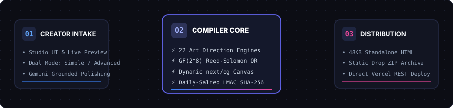
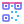

<p align="center">
  <a href="https://github.com/VarshuDev/folio">
    
  </a>
</p>

<p align="center">
  <strong>An opinionated personal portfolio studio, aesthetic compiler, and zero-dependency static engine.</strong>
</p>

<p align="center">
  <a href="https://nextjs.org"></a>
  <a href="https://react.dev"></a>
  <a href="https://www.typescriptlang.org"></a>
  <a href="https://supabase.com"></a>
  <a href="https://vercel.com"></a>
  <a href="LICENSE"></a>
</p>

<p align="center">
  <a href="#quickstart"> Quickstart</a> &nbsp;&bull;&nbsp;
  <a href="#22-handcrafted-art-directions"> 22 Art Directions</a> &nbsp;&bull;&nbsp;
  <a href="#compiler-pipeline--architecture"> Architecture</a> &nbsp;&bull;&nbsp;
  <a href="#zero-lock-in-compilation-targets"> Export Engine</a> &nbsp;&bull;&nbsp;
  <a href="#privacy-first-cookieless-telemetry"> Privacy Spec</a> &nbsp;&bull;&nbsp;
  <a href="#test-suite--rigor"> Test Suite</a>
</p>

---

##  Why Folio?

Most modern portfolio solutions force developers into one of two compromises: **cookie-cutter templates** that look like generic SaaS marketing pages, or **proprietary hosting lock-ins** that inject invasive tracking scripts, pop-up consent banners, and recurring subscriptions.

**Folio is engineered differently:**

1. **22 Expressive Art Directions**: From Swiss Modernism to Cyberpunk Arcade, Neo-Brutalism, and Technical Blueprints. Every style is a complete, structural design paradigm—not just an interchangeable color swap.
2. **Zero-Lock-In Static Compiler**: Compile your portfolio into a **single 48KB offline HTML file** with inlined CSS, a static ZIP bundle for GitHub Pages/Netlify, or a fully scaffolded Next.js 16 multi-page application.
3. **Cryptographic Cookieless Analytics**: Measure real visitor engagement without dropping a single cookie, storing an IP address, or displaying a GDPR cookie banner.
4. **Headless Vercel REST Deployment**: Connect directly to Vercel via pure REST API endpoints with SHA-1 asset deduplication. No intermediate GitHub repository required unless you want one.
5. **Grounded AI Copy Assistance**: Intelligent, non-hallucinatory bio and project polish powered by Google Gemini, enforced by strict review boundaries.

---

##  Compiler Pipeline &amp; Architecture

Folio operates as an end-to-end compilation pipeline. The diagram below illustrates how creator data flows from the visual studio into compiled static artifacts and edge distribution:

<p align="center">
  
</p>

```
  ┌──────────────────────┐       ┌────────────────────────┐       ┌──────────────────────┐
  │   Creator Intake     │  ───► │  Style & Core Engine   │  ───► │  Distribution Edge   │
  │                      │       │                        │       │                      │
  │ • Visual Studio UI   │       │ • 22 Structural Themes │       │ • 48KB Offline HTML  │
  │ • Dual Builder Modes │       │ • GF(2^8) Reed-Solomon │       │ • Static Drop ZIP    │
  │ • Gemini AI Polish   │       │ • Dynamic next/og SVG  │       │ • Vercel REST Deploy │
  │ • Draft Auto-Save    │       │ • HMAC SHA-256 Hasher  │       │ • Custom Domains     │
  └──────────────────────┘       └────────────────────────┘       └──────────────────────┘
```

---

##  22 Handcrafted Art Directions

Folio rejects homogenous design. Each theme represents an intentional visual philosophy with distinct layout rhythms, custom typographic pairings, and bespoke micro-interactions:

> [!TIP]
> **Complete Visual Showcase &amp; High-Res Screenshots**: View full desktop (1440 × 900) and mobile (390 × 844) side-by-side screenshots, typography stacks, and design philosophies in **[THEMES.md](THEMES.md)**.

<table align="center" width="100%">
  <thead>
    <tr>
      <th align="left">Aesthetic Family</th>
      <th align="left">Design Philosophy</th>
      <th align="left">Key Included Themes</th>
    </tr>
  </thead>
  <tbody>
    <tr>
      <td><strong> Core &amp; Editorial</strong></td>
      <td>Clean reading measures, literary rail navigation, quiet pacing</td>
      <td><code>minimal</code>, <code>editorial</code>, <code>project</code></td>
    </tr>
    <tr>
      <td><strong> Modernist &amp; Structured</strong></td>
      <td>1950s International Typographic Style, mathematical grids</td>
      <td><code>swiss</code>, <code>bauhaus</code>, <code>gallery</code></td>
    </tr>
    <tr>
      <td><strong> Technical &amp; Systems</strong></td>
      <td>Monospace hierarchy, green CRT phosphor, engineering blueprints</td>
      <td><code>terminal</code>, <code>blueprint</code>, <code>academic</code></td>
    </tr>
    <tr>
      <td><strong> Creative &amp; Cyberpunk</strong></td>
      <td>Scanline telemetry, ambient neon grids, midnight jazz vibes</td>
      <td><code>arcade</code>, <code>after-hours</code>, <code>retro</code>, <code>y2k</code></td>
    </tr>
    <tr>
      <td><strong> High-Impact Visual</strong></td>
      <td>Solid black borders, raw offset shadows, archival broadsheet</td>
      <td><code>brutalist</code>, <code>newsprint</code>, <code>botanical</code>, <code>zine</code></td>
    </tr>
  </tbody>
</table>

<p align="center">
  <a href="THEMES.md"><strong>👉 Explore the Full 22-Theme Visual Showcase with Screenshots in THEMES.md →</strong></a>
</p>

<details>
<summary><strong> Click to expand the full 22-Theme Catalog &amp; Typography Specs</strong></summary>
<br>

| Theme ID | Name | Category | Primary Mood &amp; Philosophy | Layout Archetype |
| :--- | :--- | :--- | :--- | :--- |
| `minimal` | **Minimal** | Recommended | Distraction-free, centered reading measure, quiet rules | Single Column Classic |
| `editorial` | **Editorial** | Recommended | Magazine contents rail, rich long-form storytelling | Asymmetric Split |
| `project` | **Project** | Recommended | Visual card showcase for high-volume makers | Responsive Grid |
| `swiss` | **Swiss** | Recommended | International Typographic Style, mathematical grids | Geometric Structured |
| `arcade` | **Arcade** | Creative | CRT scanlines, 80s arcade aesthetics, neon borders | High-Contrast Dark |
| `after-hours` | **After Hours** | Creative | Midnight jazz lounge vibes, moody indigo gradients | Fluid Ambient |
| `terminal` | **Terminal** | Technical | Hacker / sysadmin CLI prompt with monospace hierarchy | Monospace Terminal |
| `blueprint` | **Blueprint** | Technical | Architectural schematic with drafting lines and grid | CAD Grid |
| `brutalist` | **Brutalist** | Visual | Raw neo-brutalism, 3px solid black borders, hard drop shadows | Offset Block Grid |
| `bauhaus` | **Bauhaus** | Visual | Primary color geometry, constructivist layout | Asymmetric Bauhaus |
| `gallery` | **Gallery** | Visual | Museum exhibition catalog, whitespace-focused | Curated Exhibition |
| `botanical` | **Botanical** | Personal | Earthy organic tones, serif headers, peaceful rhythm | Warm Organic |
| `pastel` | **Pastel** | Personal | Soft vapor aesthetics, pill navigation, playful cards | Rounded Modern |
| `y2k` | **Y2K** | Creative | Early 2000s cyber web, iridescent chrome gradients | Nostalgic Cyber |
| `retro` | **Retro** | Creative | 1970s warm print press, retro typography | Vintage Print |
| `pinboard` | **Pinboard** | Personal | Physical corkboard layout with pinned notes &amp; index cards | Freeform Pinboard |
| `newsprint` | **Newsprint** | Editorial | Broadside newspaper columns with serif body text | Multi-Column Press |
| `academic` | **Academic** | Editorial | Clean LaTeX paper aesthetic with citation anchors | Scholarly Monograph |
| `zine` | **Zine** | Creative | Indie photocopied DIY zine, rotated stamps &amp; badges | Punk Collage |
| `documentary`| **Documentary** | Personal | Cinematic photography portfolio with widescreen headers | Filmstrip Focus |
| `community` | **Community** | Personal | Open-source advocate layout with social links front &amp; center | Social Networked |
| `case-study` | **Case Study** | Recommended | In-depth engineering problem/solution breakdown | Deep-Dive Narrative |

</details>

---

##  Zero-Lock-In Compilation Targets

Folio guarantees complete ownership of your work. You can export or deploy your portfolio through three distinct compilation targets:

```
                  ┌──────────────────────────────────────────────┐
                  │           FOLIO PROFILE SPEC                 │
                  └──────────────────────┬───────────────────────┘
                                         │
                 ┌───────────────────────┼──────────────────────┐
                 ▼                       ▼                      ▼
      ┌─────────────────────┐ ┌─────────────────────┐ ┌─────────────────────┐
      │  Single-File HTML   │ │   Static Drop ZIP   │ │  Next.js 16 Project │
      │                     │ │                     │ │                     │
      │ • 48KB total weight │ │ • Drag & Drop ready │ │ • Multi-page routes │
      │ • Inlined SVG & CSS │ │ • GitHub Pages      │ │ • Dynamic OG images │
      │ • 100% offline-ready│ │ • Netlify / Cloudfl.│ │ • Full source code  │
      └─────────────────────┘ └─────────────────────┘ └─────────────────────┘
```

1. **48KB Standalone Single-File HTML**:
   - Zero external scripts, zero external font stylesheets, zero CDN dependencies.
   - All styles, vector icons, and layout structures are inlined directly into a single self-contained `.html` file.
   - Runs instantly from a local USB drive, email attachment, or local preview.

2. **Static Drop ZIP Archive**:
   - Pre-bundled with `index.html`, responsive styling, and an automated deployment `README.md`.
   - Ready for instant drag-and-drop hosting on **GitHub Pages**, **Netlify Drop**, or **Cloudflare Pages**.

3. **Full Next.js 16 (Turbopack) Application**:
   - Compiles a complete, standalone TypeScript project with route handlers, dynamic `next/og` OpenGraph cards, and contact form handling.
   - Fully decoupled from Folio—host anywhere that runs Node.js or edge servers.

---

##  Privacy-First Cookieless Telemetry

Unlike traditional analytics platforms that rely on invasive third-party cookies and persistent cross-site tracking, Folio incorporates a **zero-cookie, privacy-first telemetry engine**:

$$\text{Visitor Token} = \operatorname{HMAC-SHA256}\Big(\text{Salt}_{\text{daily}},\; \text{IP Address} \;\parallel\; \text{User-Agent}\Big)$$

- **Zero Cookie Banners Required**: Because no identifier is written to the visitor's device, your portfolio is 100% compliant with GDPR, ePrivacy, and CCPA out of the box.
- **Daily Salt Rotation**: Telemetry salts rotate every 24 hours. A visitor today cannot be tracked or correlated against their visit tomorrow.
- **Zero Raw Data Persistence**: IP addresses and raw user-agent strings are strictly hashed in memory and immediately discarded. Never written to disk or database.
- **Metrics Tracked**: Total pageviews, daily unique visitors, normalized referrers (GitHub, X/Twitter, LinkedIn, Direct), and outbound link click counts.

---

##  Grounded AI Copy Assistance

Folio includes an integrated copy refinement assistant powered by **Google Gemini**, engineered with strict anti-hallucination boundaries:

- **Bounded Action Contracts**: The assistant is constrained to exactly three operations:
  - `Make clearer` (eliminates jargon, improves cadence)
  - `Shorten` (condenses text for mobile viewports)
  - `Make more professional` (polishes tone for hiring managers)
- **Factual Grounding Defense**: Prompts are strictly bounded to the factual context supplied by the creator. The model is forbidden from inventing company names, dates, or credentials.
- **Mandatory Human-in-the-Loop**: Every AI suggestion is presented as an interactive diff with explicit **Accept**, **Edit**, or **Dismiss** controls.

---

##  Pure TypeScript Vector QR Engine

Folio features an internal, zero-dependency QR code generator built entirely in TypeScript:

- Compliant with the **ISO/IEC 18004** international standard.
- Implements Galois Field $\text{GF}(2^8)$ polynomial mathematics for Reed-Solomon error correction.
- Emits high-contrast, mathematically pure **SVG vector graphics** with customizable foreground and background tones.
- Zero client-side canvas dependencies; 100% server-side and static compile compatible.

---

##  Headless Vercel Deployment

Deploy directly to your custom production domain on Vercel with zero friction:

```
[ Folio Studio ] ───( SHA-1 Digest )───► [ POST /v2/files ] ───► [ POST /v13/deployments ] ───► [ Live Edge URL ]
```

- **Direct REST Integration**: Uses Vercel's Files API (`POST /v2/files`) and Deployments API (`POST /v13/deployments`) with SHA-1 asset deduplication.
- **No Git Repository Required**: Deploys project file trees directly into Vercel's build pipeline without requiring write access to your GitHub account.
- **Strict Server Secret Boundary**: OAuth tokens, client secrets, and deployment tokens remain strictly isolated on server-side endpoints and are never sent to the browser.

---

##  Quickstart

### Prerequisites
- **Node.js** 20.0 or higher
- **npm** or **pnpm**

### 1. Clone &amp; Install

```bash
# Clone the repository
git clone https://github.com/VarshuDev/folio.git

# Enter the project directory
cd folio

# Install dependencies
npm install
```

### 2. Configure Environment

```bash
cp .env.example .env.local
```

*(Optional: Fill in Supabase or Gemini keys in `.env.local`. If left blank, Folio seamlessly runs in local memory mode with browser-persisted drafts!)*

### 3. Launch Development Server

```bash
npm run dev
```

Open [http://localhost:3000](http://localhost:3000) in your browser:

- **Studio Builder**: `http://localhost:3000/studio`
- **Visual QA Theme Showcase**: `http://localhost:3000/template-demos`
- **Account &amp; Messages Inbox**: `http://localhost:3000/account`
- **Public Portfolio Route**: `http://localhost:3000/p/[slug]`

---

##  Test Suite &amp; Rigor

Folio is backed by an automated test suite verifying compilers, security boundaries, and rendering engines:

```bash
# Run the complete test suite (180+ tests)
npm test

# Run TypeScript typecheck
npm run typecheck

# Run Turbopack production build
npm run build
```

| Engine Under Test | Test Command | Verification Scope |
| :--- | :--- | :--- |
| **Publishing &amp; Deploy** | `npm run test:publishing` | Slug sanitization, OAuth replay protection, Vercel REST payload validation |
| **AI Boundaries** | `npm run test:ai` | Prompt injection defense, hallucination prevention, diff merging |
| **Export Compiler** | `npm run test:export` | IEEE 802.3 CRC-32 integrity, PKZIP Deflate format, standalone HTML |
| **Cookieless Analytics**| `npm run test:analytics` | Salt rotation lifecycle, hash collision prevention, zero IP leakage |
| **Vector QR Engine** | `npm run test:qr` | Galois Field $\text{GF}(2^8)$ polynomials, version matrices, clean SVG paths |
| **Contact Honeypot** | `npm run test:contact` | Honeypot trap triggers, sliding-window rate limiters, message isolation |
| **Dev Credits Ledger** | `npm run test:credits` | Ledger immutability, idempotent balance constraints |

---

##  Security &amp; Integrity

- **Zero Plaintext Secrets**: All sensitive secrets (`SUPABASE_SERVICE_ROLE_KEY`, `VERCEL_CLIENT_SECRET`) are enforced server-only.
- **Bot Honeypot Defense**: Public portfolio contact endpoints feature silent honeypots (`hp_company`) and IP sliding-window limiters (maximum 3 messages per hour).
- **Subresource Integrity**: Exported HTML bundles use zero external dependencies, neutralizing third-party supply-chain attacks.

---

##  Author &amp; Credits

Engineered and maintained with care by **[VarshuDev](https://github.com/VarshuDev)**.

If you find Folio useful for your developer portfolio, consider starring  the repository!

Released under the **[MIT License](LICENSE)**.
