# 🎨 Folio Visual Gallery &amp; Art Directions Showcase

> **An opinionated, zero-dependency portfolio compiler with 22 handcrafted architectural styles.**  
> Every theme represents a distinct design paradigm with bespoke typography pairings, mathematical grid rhythms, custom color harmonies, and responsive mobile adaptations.

  <a href="README.md"><strong>← Back to Folio Main README</strong></a> &nbsp;&bull;&nbsp;
  <a href="#recommended-core-archetypes">Recommended Archetypes</a> &nbsp;&bull;&nbsp;
  <a href="#creative--high-contrast">Creative Styles</a> &nbsp;&bull;&nbsp;
  <a href="#technical--monospace">Technical Styles</a> &nbsp;&bull;&nbsp;
  <a href="#high-impact-visual">High-Impact Visual</a> &nbsp;&bull;&nbsp;
  <a href="#publishing--editorial">Publishing &amp; Narrative</a> &nbsp;&bull;&nbsp;
  <a href="#accessibility--grayscale-contrast-audits">Accessibility &amp; Grayscale</a>

---

## 🏛️ Recommended Core Archetypes

### 1. Minimal (`minimal`)
Centered reading measure, distraction-free typographic hierarchy, quiet dividers, and whisper-soft borders. Perfect for writers, architects, and designers who want their work to speak without decorative noise.

<table width="100%">
  <tr>
    <th width="70%">Desktop (1440 × 900)</th>
    <th width="30%">Mobile (390 × 844)</th>
  </tr>
  <tr>
    <td align="center">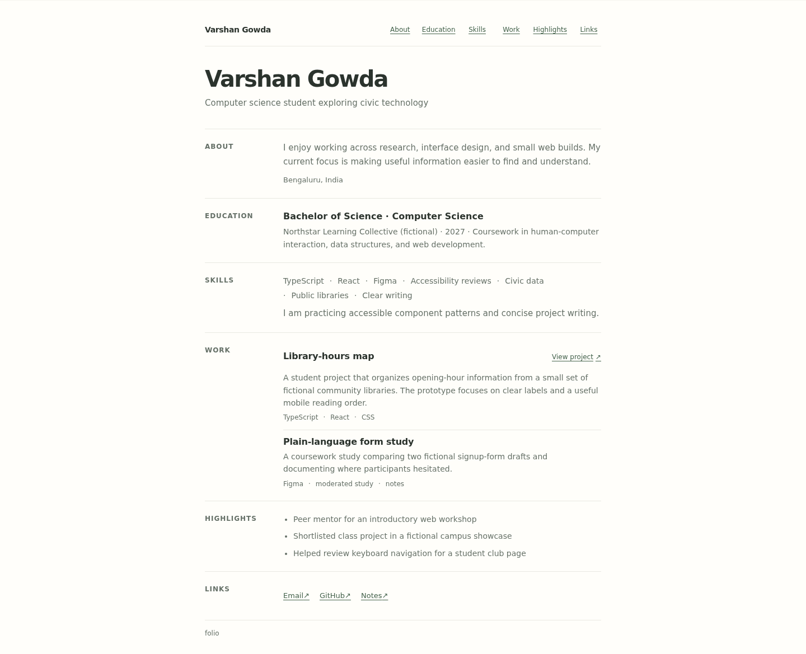</td>
    <td align="center">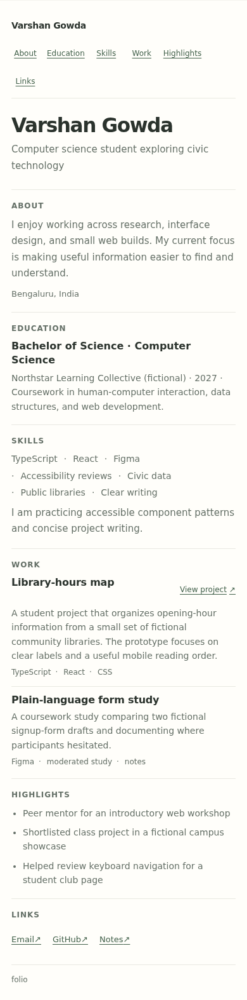</td>
  </tr>
</table>

- **Typography**: Inter / System UI with generous line height ($1.65$).
- **Palette**: Monochromatic slate (`#0f172a` text, `#f8fafc` surface).
- **Archetype**: Single Column Classic with sticky anchor navigation.

---

### 2. Editorial Minimalist (`editorial`)
Asymmetric contents rail inspired by high-end literary magazines and print publications. Features a persistent left masthead and smooth scrollytelling rhythm.

<table width="100%">
  <tr>
    <th width="70%">Desktop (1440 × 900)</th>
    <th width="30%">Mobile (390 × 844)</th>
  </tr>
  <tr>
    <td align="center">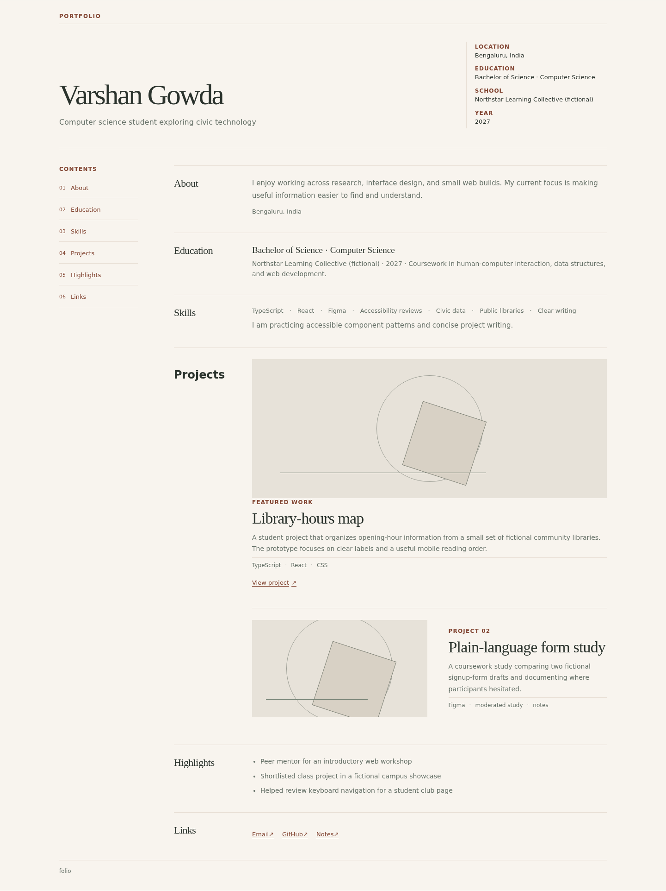</td>
    <td align="center">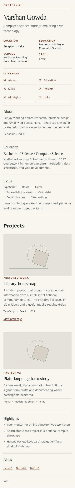</td>
  </tr>
</table>

- **Typography**: Editorial Serif headers paired with clean neutral grotesque sans body.
- **Palette**: Warm ivory background (`#faf9f5`), rich charcoal text (`#1c1917`), and burgundy accents.
- **Archetype**: Asymmetric Split Rail with synchronized section highlighting.

---

### 3. Project Showcase (`project`)
Engineered specifically for high-volume makers, product engineers, and open-source contributors with deep project portfolios.

<table width="100%">
  <tr>
    <th width="70%">Desktop (1440 × 900)</th>
    <th width="30%">Mobile (390 × 844)</th>
  </tr>
  <tr>
    <td align="center">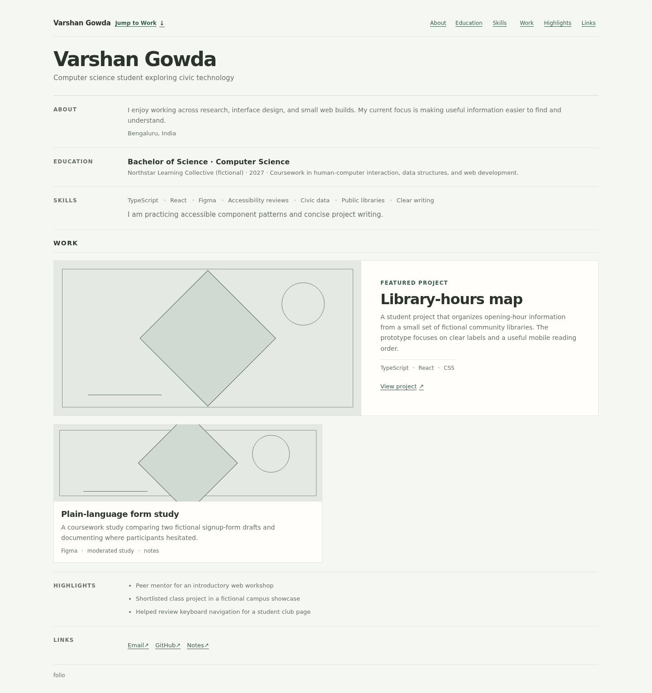</td>
    <td align="center">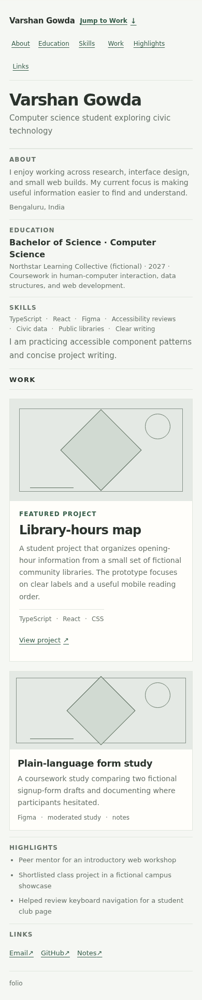</td>
  </tr>
</table>

- **Typography**: Technical geometric sans with bold tabular numerals.
- **Palette**: Deep navy graphite (`#0b0f19`) with cyan and indigo interactive tags.
- **Archetype**: Responsive Multi-Card Grid with live tag filtering.

---

### 4. Swiss Modernist (`swiss`)
Rooted in the 1950s International Typographic Style: strict mathematical grids, asymmetric balance, heavy contrast sans-serifs, and zero gratuitous ornamentation.

<table width="100%">
  <tr>
    <th width="70%">Desktop (1440 × 900)</th>
    <th width="30%">Mobile (390 × 844)</th>
  </tr>
  <tr>
    <td align="center">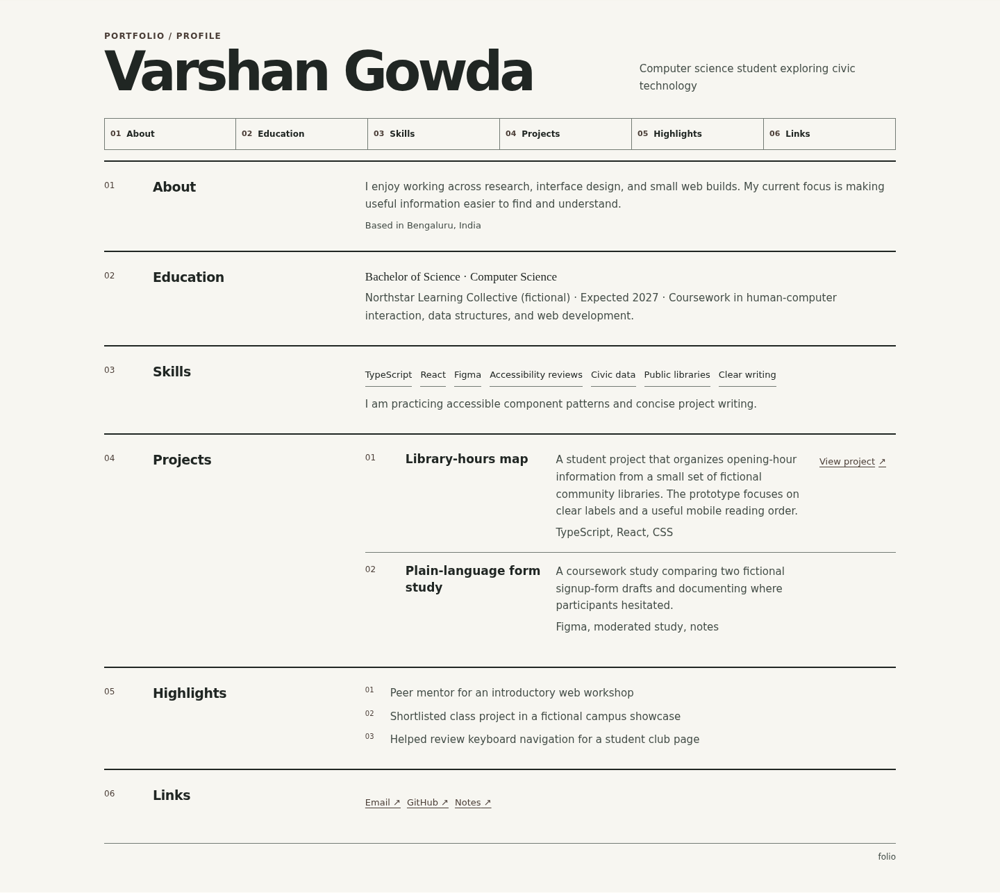</td>
    <td align="center">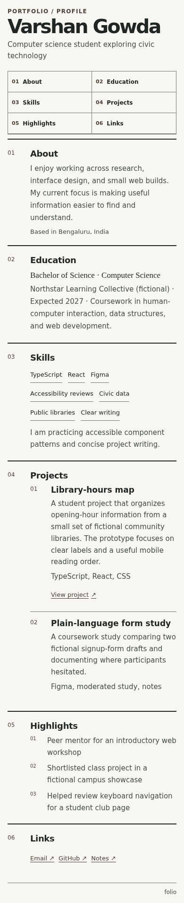</td>
  </tr>
</table>

- **Typography**: Neue Haas Grotesk / Helvetica Neue with ultra-bold headings.
- **Palette**: Stark pure white (`#ffffff`), solid jet black (`#000000`), and bold vermillion red (`#e11d48`).
- **Archetype**: 12-Column Geometric Modular Grid.

---

## 🕹️ Creative &amp; High-Contrast

### 5. Arcade &amp; Cyberpunk (`arcade`)
Nostalgic 1980s coin-op CRT aesthetic with simulated phosphor scanlines, glowing neon bounding boxes, and arcade high-score telemetry.

<table width="100%">
  <tr>
    <th width="70%">Desktop (1440 × 900)</th>
    <th width="30%">Mobile (390 × 844)</th>
  </tr>
  <tr>
    <td align="center">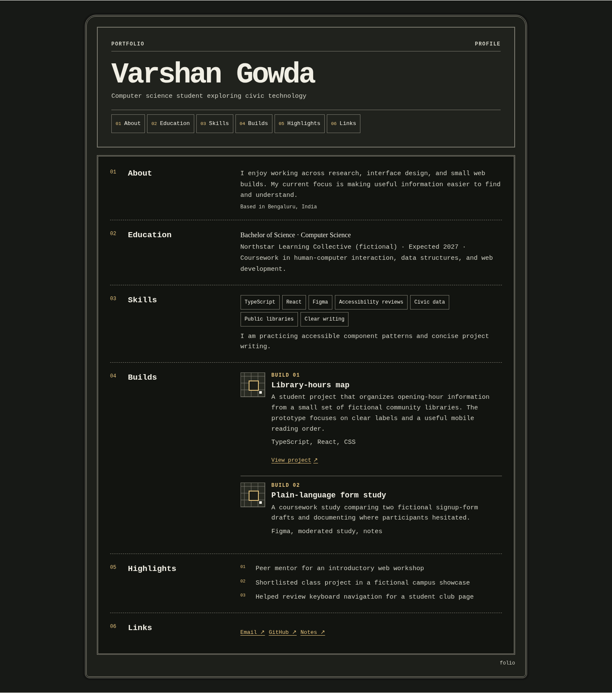</td>
    <td align="center">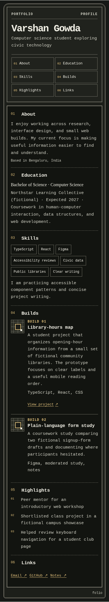</td>
  </tr>
</table>

- **Typography**: Pixel/Bit fonts for stats, paired with high-legibility sci-fi display faces.
- **Palette**: Void black (`#09090b`), electric magenta (`#ec4899`), and cyan glow (`#06b6d4`).
- **Archetype**: High-Score Ledger &amp; Neon CRT Frame.

---

### 6. After Hours (`after-hours`)
Moody, atmospheric midnight jazz lounge vibes featuring fluid indigo mesh gradients and subtle frosted glass surfaces.

<table width="100%">
  <tr>
    <th width="70%">Desktop (1440 × 900)</th>
    <th width="30%">Mobile (390 × 844)</th>
  </tr>
  <tr>
    <td align="center">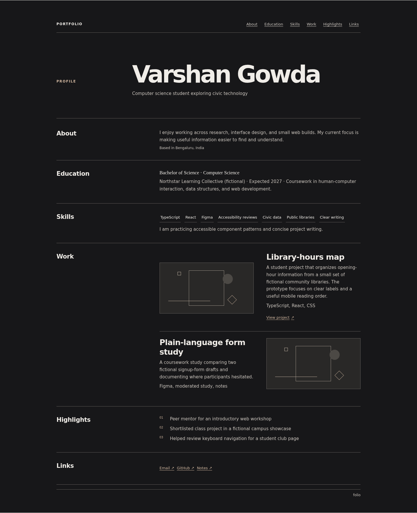</td>
    <td align="center">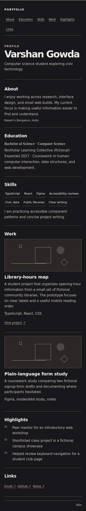</td>
  </tr>
</table>

- **Typography**: Elegant wide-spaced display sans with relaxed tracking.
- **Palette**: Deep midnight indigo (`#080a14`), violet ambient glow (`#7c3aed`), and amber accents.
- **Archetype**: Fluid Ambient Dark Mode with backdrop blur.

---

### 7. Retro Computer (`retro`)
Classic early-90s desktop operating system nostalgia complete with beveled grey button chrome, title bars, and dotted focus outlines.

<table width="100%">
  <tr>
    <th width="70%">Desktop (1440 × 900)</th>
    <th width="30%">Mobile (390 × 844)</th>
  </tr>
  <tr>
    <td align="center">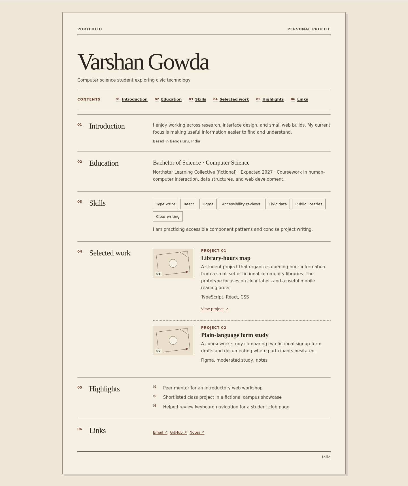</td>
    <td align="center">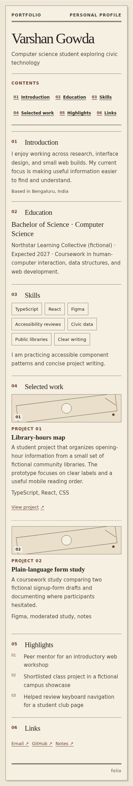</td>
  </tr>
</table>

---

### 8. Pinboard &amp; Cork (`pinboard`)
Tactile desk surface with sticky-note cards, washi tape rotation transforms, and casual pinboard organization.

<table width="100%">
  <tr>
    <th width="70%">Desktop (1440 × 900)</th>
    <th width="30%">Mobile (390 × 844)</th>
  </tr>
  <tr>
    <td align="center">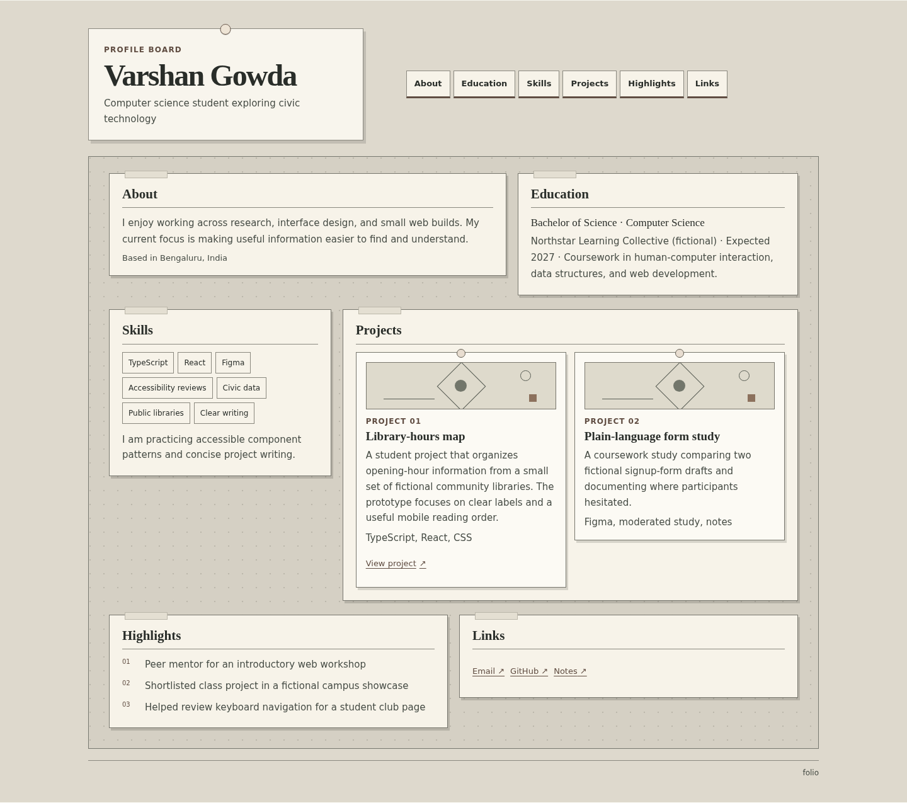</td>
    <td align="center">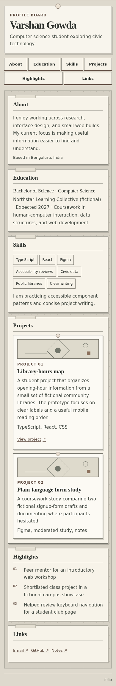</td>
  </tr>
</table>

---

## 💻 Technical &amp; Monospace

### 9. Terminal CLI (`terminal`)
Full-fidelity hacker and sysadmin terminal environment: green phosphor text, command prompt indicators (`$`), blinking cursors, and ASCII borders.

<table width="100%">
  <tr>
    <th width="70%">Desktop (1440 × 900)</th>
    <th width="30%">Mobile (390 × 844)</th>
  </tr>
  <tr>
    <td align="center">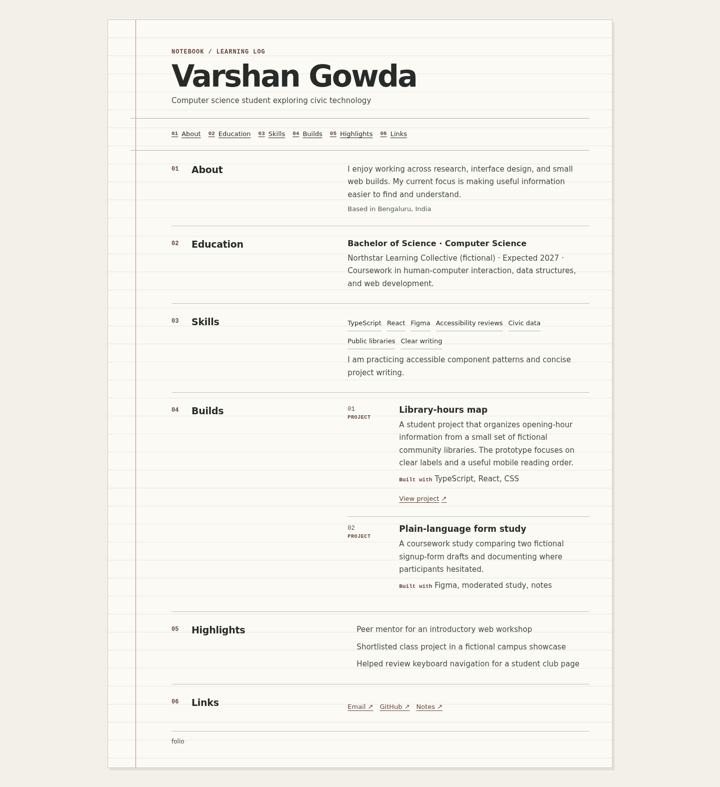</td>
    <td align="center">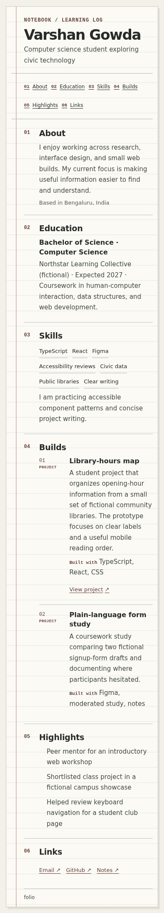</td>
  </tr>
</table>

- **Typography**: 100% JetBrains Mono / Fira Code monospace hierarchy.
- **Palette**: Pure CRT phosphor green (`#22c55e`) on obsidian black (`#0a0a0a`).
- **Archetype**: Monospace Command Prompt Shell.

---

### 10. Technical Blueprint (`blueprint`)
Architectural drafting schematics featuring fine cyan measurement gridlines, engineering dimension markers, and drafting metadata blocks.

<table width="100%">
  <tr>
    <th width="70%">Desktop (1440 × 900)</th>
    <th width="30%">Mobile (390 × 844)</th>
  </tr>
  <tr>
    <td align="center">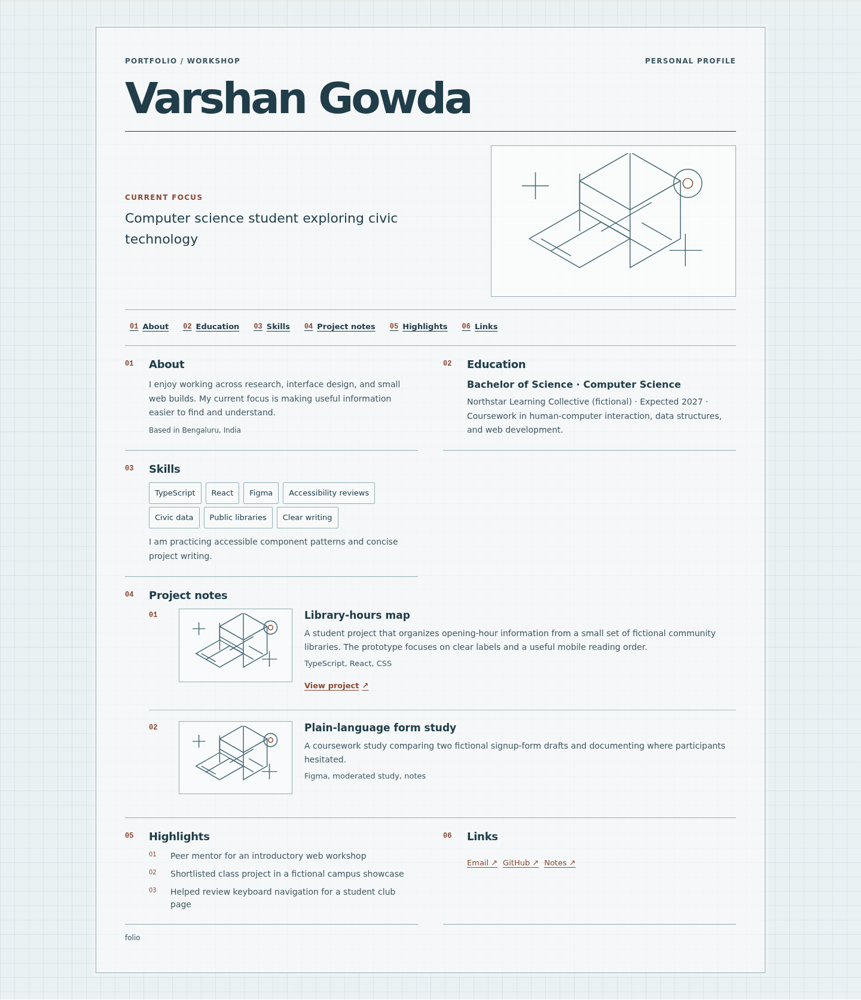</td>
    <td align="center">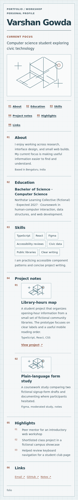</td>
  </tr>
</table>

- **Typography**: Technical CAD drafting sans with engineering monospace metrics.
- **Palette**: Blueprint drafting cyan (`#0284c7`), cobalt ground (`#0c192c`), and white coordinate axes.
- **Archetype**: CAD Blueprint Grid with millimeter registration crosshairs.

---

### 11. Academic Monograph (`academic`)
Refined university thesis aesthetic with double-column layout options, formal citation brackets, and LaTeX-inspired mathematical typography.

<table width="100%">
  <tr>
    <th width="70%">Desktop (1440 × 900)</th>
    <th width="30%">Mobile (390 × 844)</th>
  </tr>
  <tr>
    <td align="center">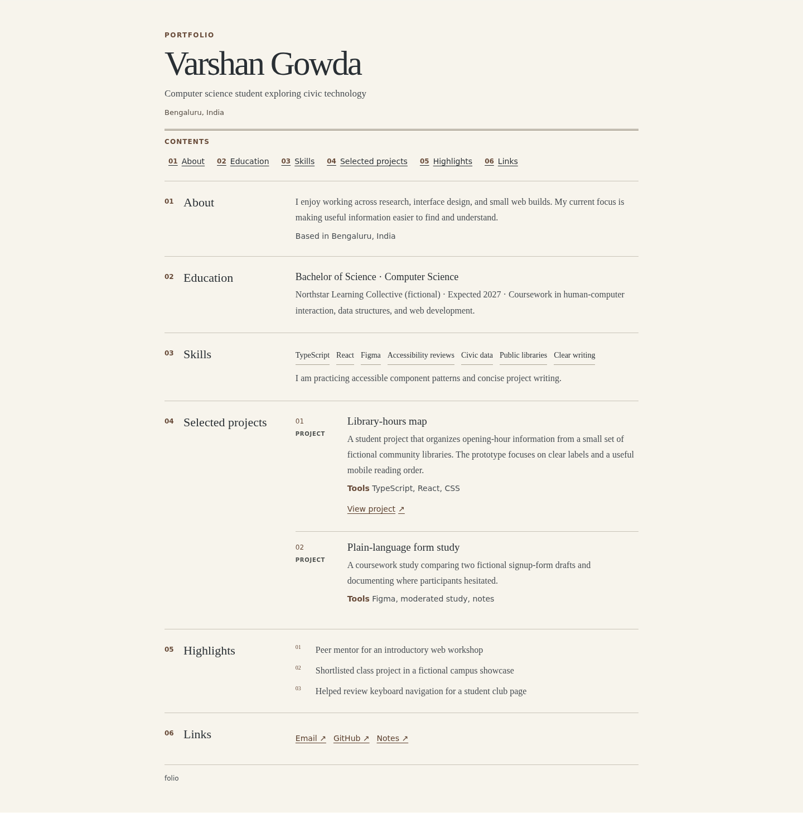</td>
    <td align="center">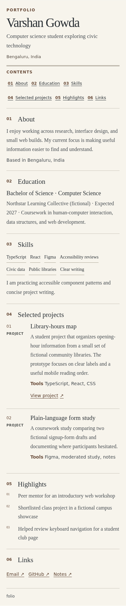</td>
  </tr>
</table>

---

## 🎨 High-Impact Visual &amp; Neo-Brutalist

### 12. Neo-Brutalist (`brutalist`)
Raw, uncompromising web design: 3px solid black outlines, un-blurred offset drop shadows (`4px 4px 0 #000`), bold pastel pills, and maximalist energy.

<table width="100%">
  <tr>
    <th width="70%">Desktop (1440 × 900)</th>
    <th width="30%">Mobile (390 × 844)</th>
  </tr>
  <tr>
    <td align="center">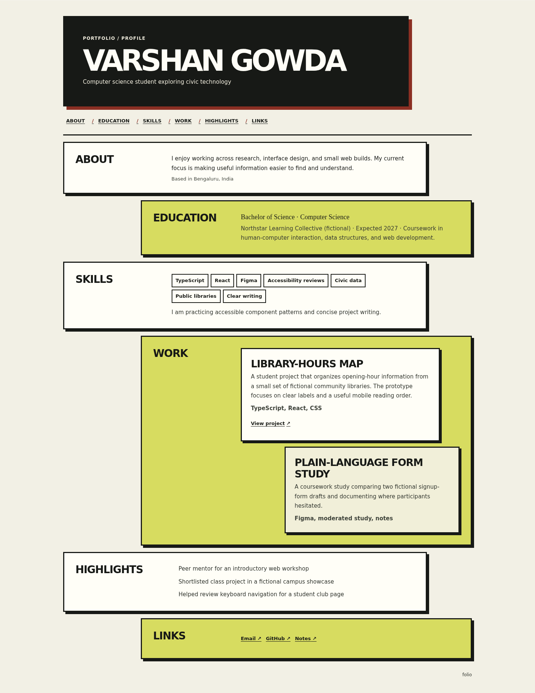</td>
    <td align="center">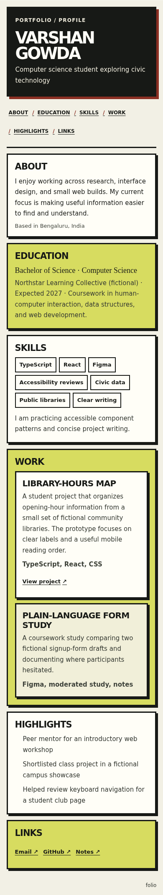</td>
  </tr>
</table>

- **Typography**: Heavy, punchy sans-serif with high x-height.
- **Palette**: Hyper-saturated yellow (`#facc15`), bold pink (`#f472b6`), and hard solid black.
- **Archetype**: Offset Solid Shadow Block Grid.

---

### 13. Bauhaus Constructivist (`bauhaus`)
Tribute to Walter Gropius and the Weimar Bauhaus movement: primary geometric forms (circle, triangle, square), primary color palette, and asymmetric balance.

<table width="100%">
  <tr>
    <th width="70%">Desktop (1440 × 900)</th>
    <th width="30%">Mobile (390 × 844)</th>
  </tr>
  <tr>
    <td align="center">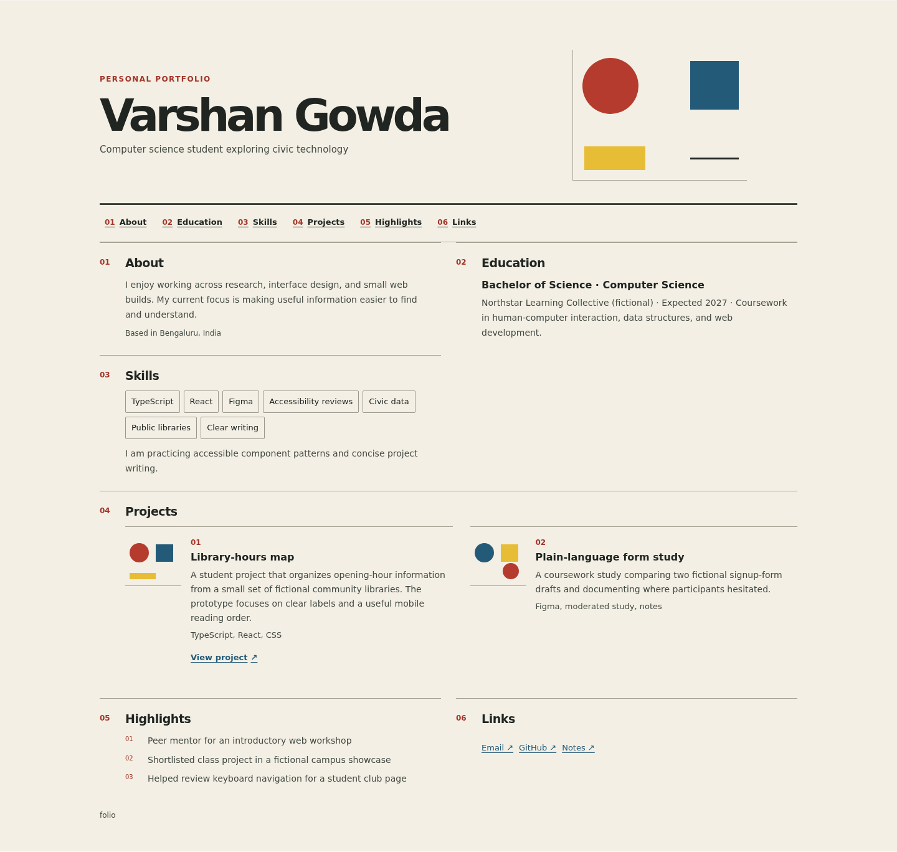</td>
    <td align="center">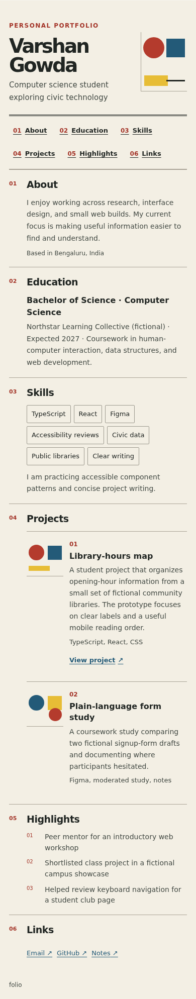</td>
  </tr>
</table>

---

### 14. Botanical Herbarium (`botanical`)
Natural earthy tones, organic warm surfaces, soft sage greens, and serene typography inspired by pressed botanical specimens.

<table width="100%">
  <tr>
    <th width="70%">Desktop (1440 × 900)</th>
    <th width="30%">Mobile (390 × 844)</th>
  </tr>
  <tr>
    <td align="center">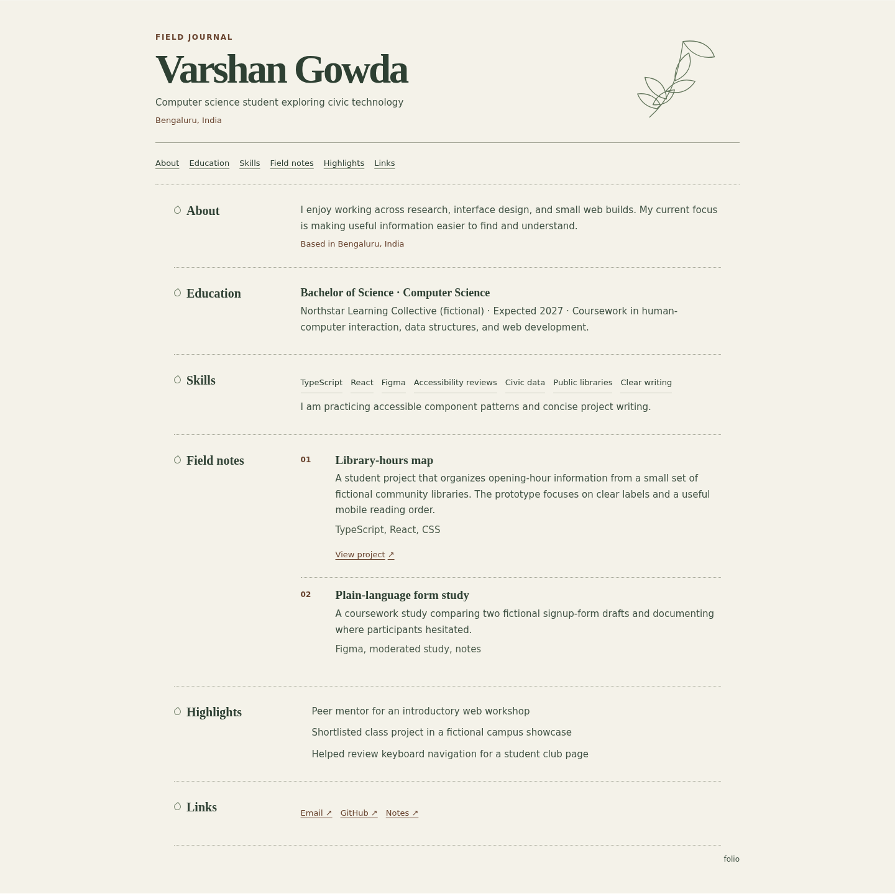</td>
    <td align="center">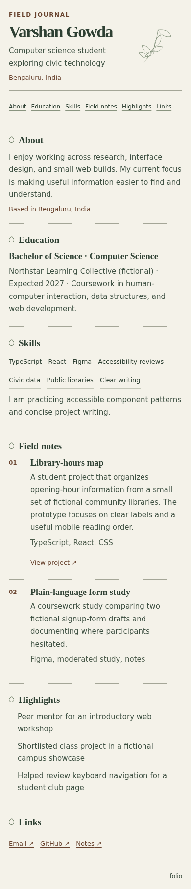</td>
  </tr>
</table>

---

### 15. Broadside Newsprint (`newsprint`)
Classic newspaper broadsheet layout with multi-column text flows, gothic masthead typography, and fine editorial hairline borders.

<table width="100%">
  <tr>
    <th width="70%">Desktop (1440 × 900)</th>
    <th width="30%">Mobile (390 × 844)</th>
  </tr>
  <tr>
    <td align="center">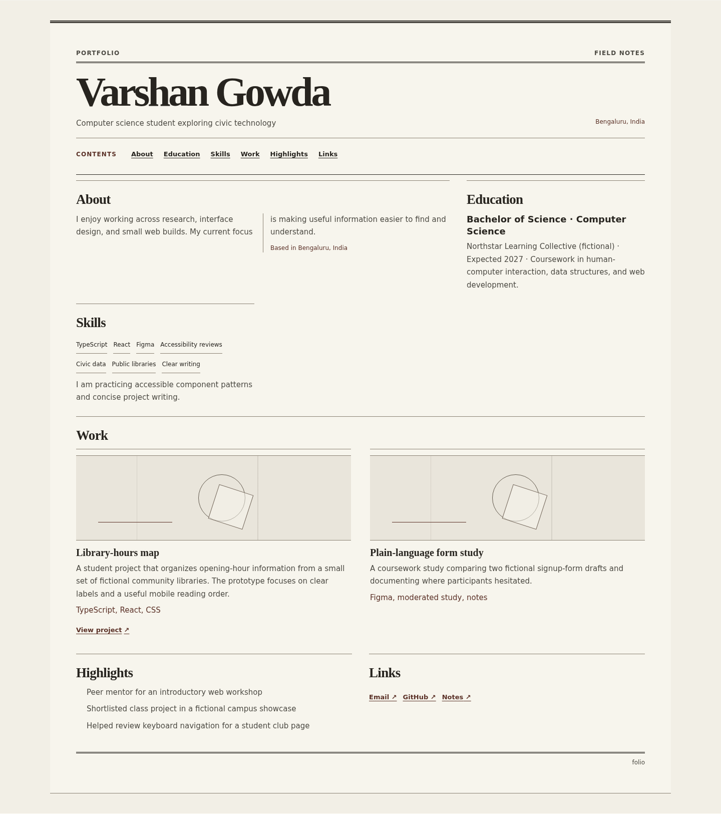</td>
    <td align="center">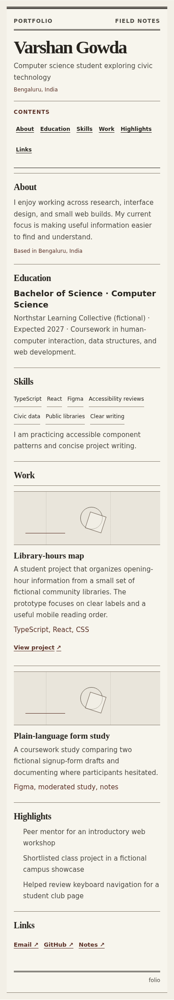</td>
  </tr>
</table>

---

### 16. Curated Gallery (`gallery`)
Museum exhibition catalog aesthetic with expansive white space, quiet wall tags, artwork framing, and deliberate pacing.

<table width="100%">
  <tr>
    <th width="70%">Desktop (1440 × 900)</th>
    <th width="30%">Mobile (390 × 844)</th>
  </tr>
  <tr>
    <td align="center">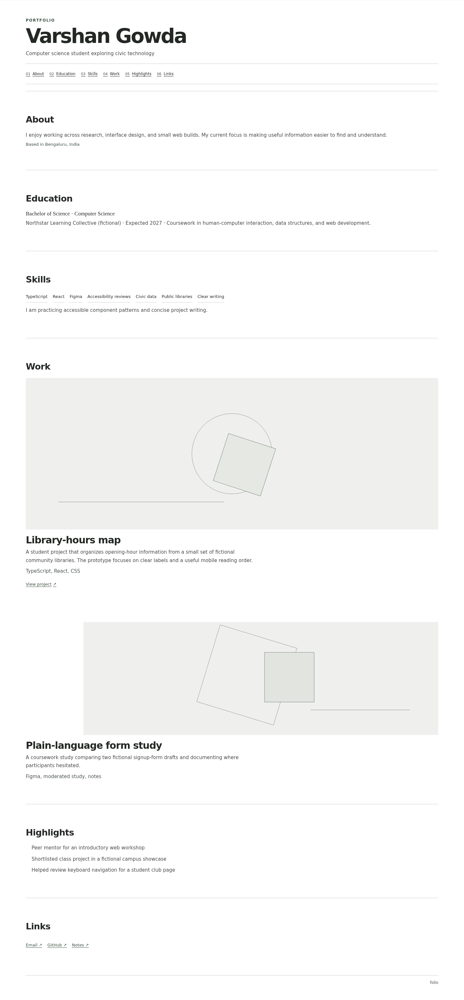</td>
    <td align="center">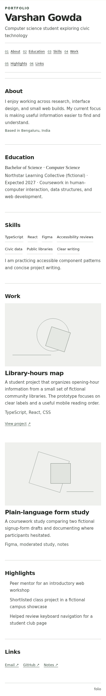</td>
  </tr>
</table>

---

### 17. Dreamy Pastel (`pastel`)
Gentle sherbet gradients, soft rounded curves, pillowy drop shadows, and approachable friendly typography.

<table width="100%">
  <tr>
    <th width="70%">Desktop (1440 × 900)</th>
    <th width="30%">Mobile (390 × 844)</th>
  </tr>
  <tr>
    <td align="center">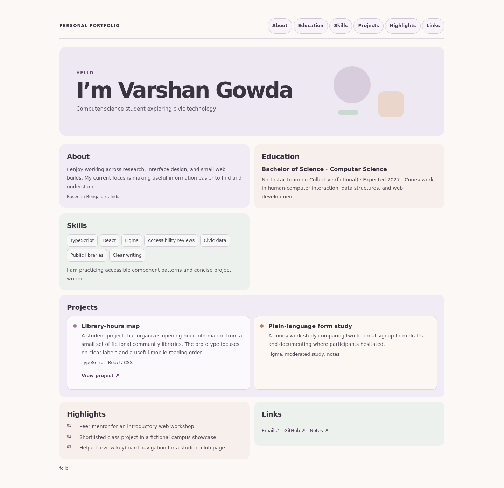</td>
    <td align="center">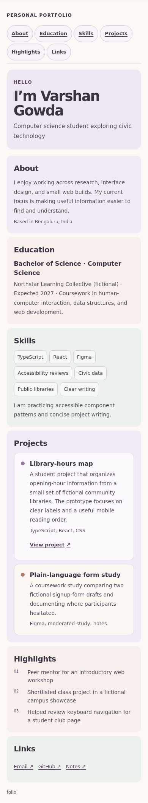</td>
  </tr>
</table>

---

### 18. Cyber Y2K Millennium (`y2k`)
Late-1990s and early-2000s cyber-optimism: metallic chrome bevels, starry flares, futuristic badge pills, and icy cyan accents.

<table width="100%">
  <tr>
    <th width="70%">Desktop (1440 × 900)</th>
    <th width="30%">Mobile (390 × 844)</th>
  </tr>
  <tr>
    <td align="center">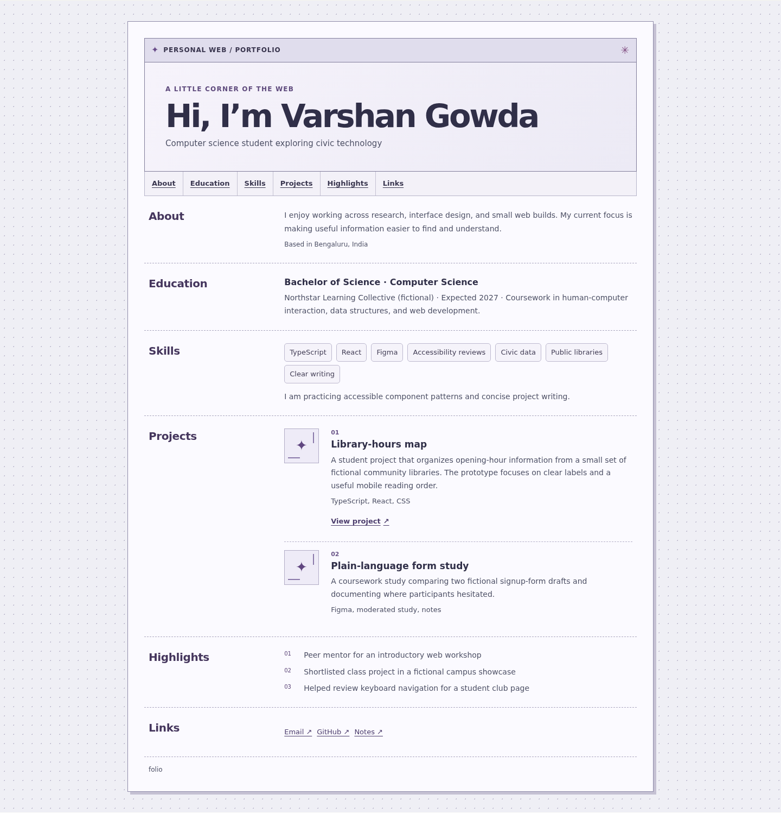</td>
    <td align="center">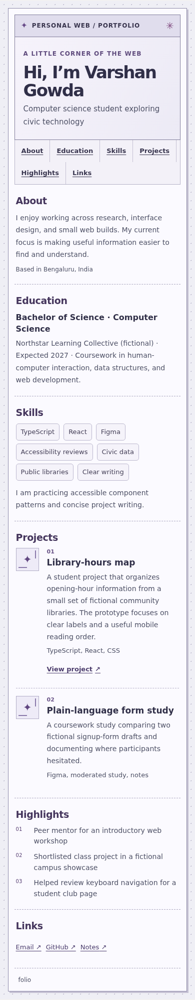</td>
  </tr>
</table>

---

## 📖 Publishing &amp; Narrative

### 19. Long-Form Case Study (`case-study`)
Built for deep-dive technical case studies, UX breakdowns, and engineering post-mortems with sticky progress telemetry and sidebar navigation.

<table width="100%">
  <tr>
    <th width="70%">Desktop (1440 × 900)</th>
    <th width="30%">Mobile (390 × 844)</th>
  </tr>
  <tr>
    <td align="center">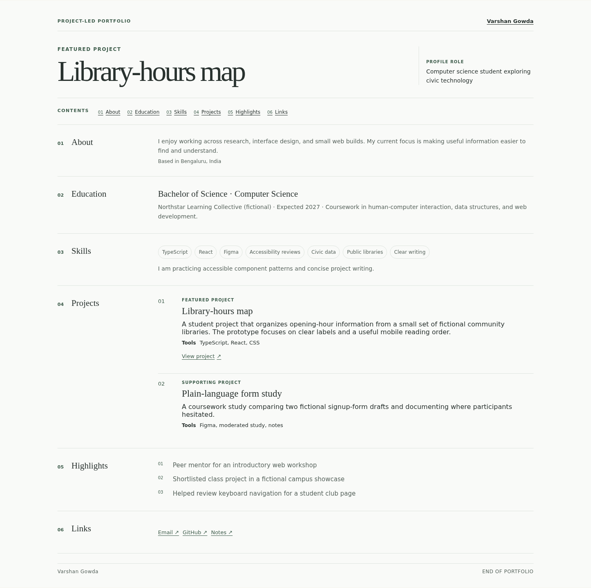</td>
    <td align="center">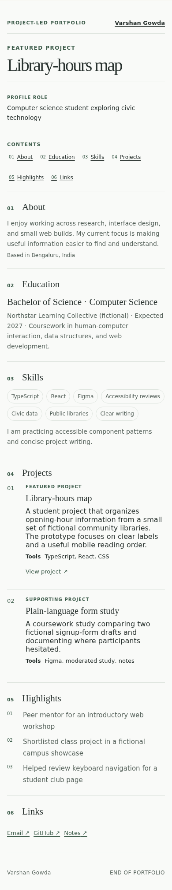</td>
  </tr>
</table>

---

### 20. Documentary Archive (`documentary`)
Historical repository pacing with archival metadata stamps, provenance markers, and warm aged parchment tones.

<table width="100%">
  <tr>
    <th width="70%">Desktop (1440 × 900)</th>
    <th width="30%">Mobile (390 × 844)</th>
  </tr>
  <tr>
    <td align="center">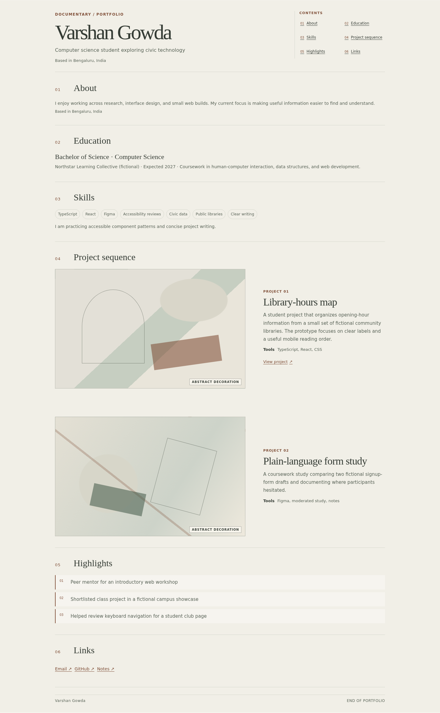</td>
    <td align="center">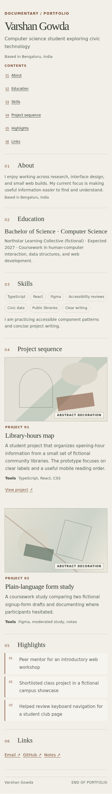</td>
  </tr>
</table>

---

### 21. Community Hub (`community`)
Optimized for developer advocates, open-source maintainers, and community leaders with event timelines, badge showcases, and contributor rails.

<table width="100%">
  <tr>
    <th width="70%">Desktop (1440 × 900)</th>
    <th width="30%">Mobile (390 × 844)</th>
  </tr>
  <tr>
    <td align="center">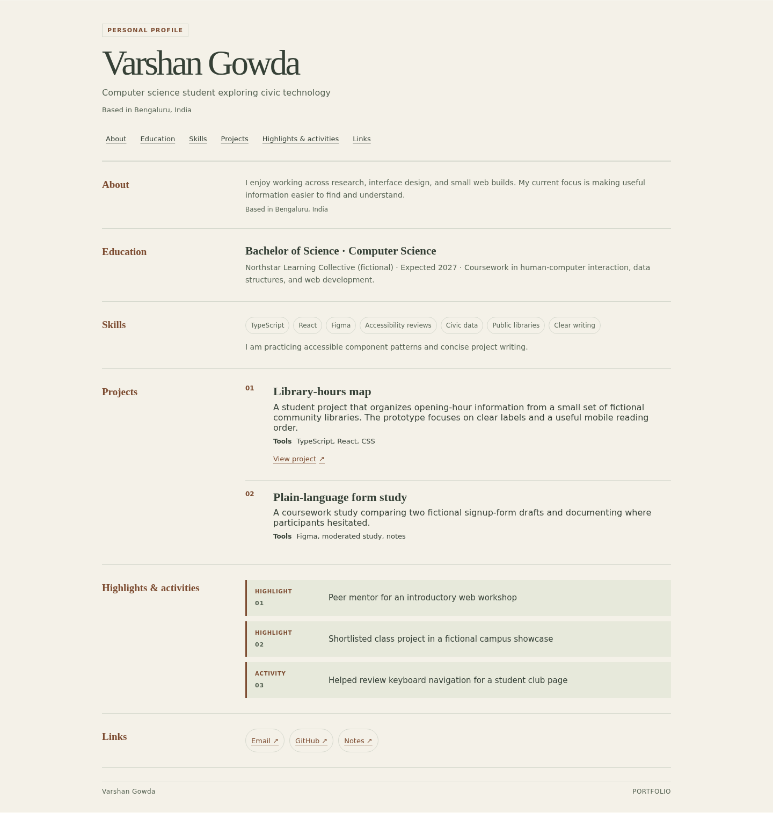</td>
    <td align="center">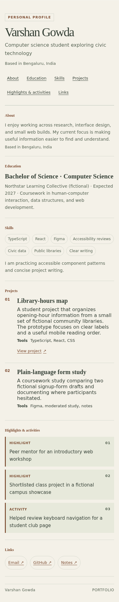</td>
  </tr>
</table>

---

### 22. Underground DIY Zine (`zine`)
Indie photocopier aesthetic with halftone textures, raw cut-and-paste collage angles, distressed typefaces, and punk underground energy.

<table width="100%">
  <tr>
    <th width="70%">Desktop (1440 × 900)</th>
    <th width="30%">Mobile (390 × 844)</th>
  </tr>
  <tr>
    <td align="center">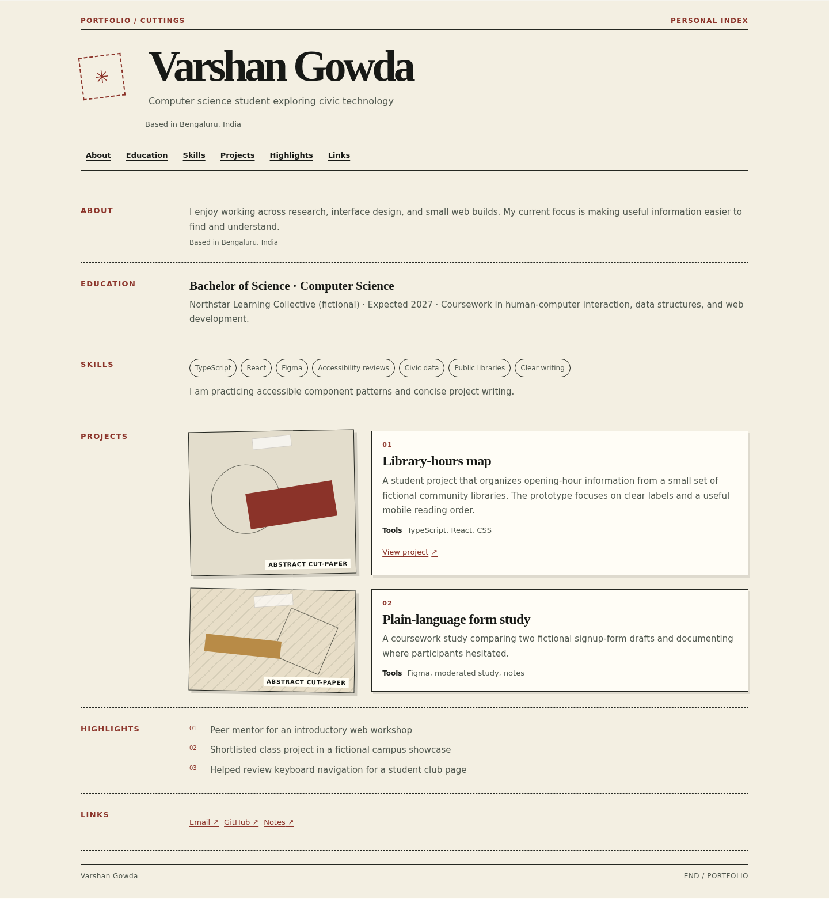</td>
    <td align="center">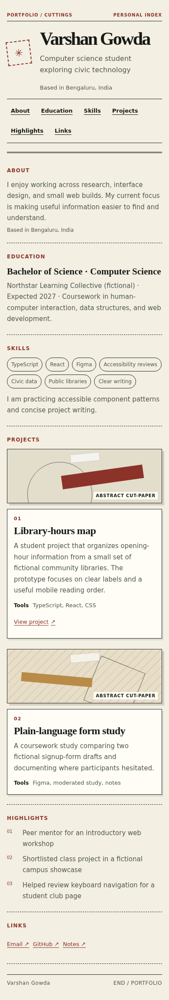</td>
  </tr>
</table>

---

## 🔬 Accessibility &amp; Grayscale Contrast Audits

Every theme in Folio is validated against strict WCAG AA / AAA contrast standards and tested in high-contrast monochromatic grayscale to guarantee that information hierarchy is never reliant on color alone:

  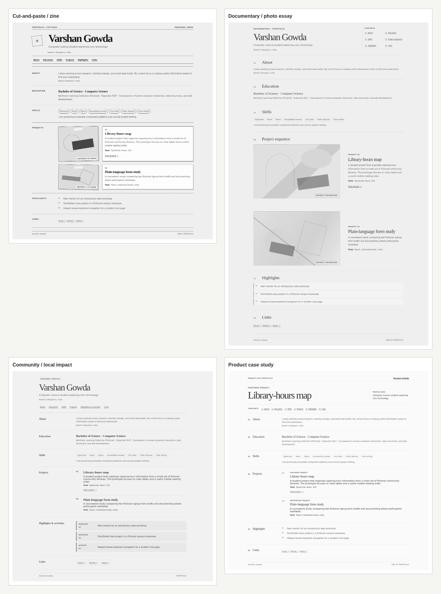

- **Contrast Ratios**: Body text maintains $\ge 4.5:1$ contrast against backgrounds; large headers maintain $\ge 3:1$.
- **Reduced Motion**: Respects `@media (prefers-reduced-motion: reduce)` by neutralizing all non-essential kinetic transforms.
- **Focus Indicators**: 2px high-visibility focus rings on all interactive elements for keyboard and screen reader accessibility.

---

  <a href="README.md"><strong>← Return to Folio Main README</strong></a>

