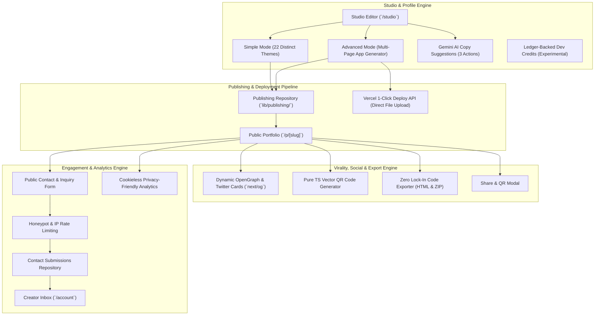

# Folio — Platform Architecture & Features Master Walkthrough

Folio is a modern personal portfolio studio and deployment engine built with Next.js 16 (Turbopack), TypeScript, and Supabase. It offers a dual-mode workflow (Simple 22-theme builder and Advanced multi-page Next.js app generator) alongside zero lock-in code export, social sharing, privacy-friendly analytics, direct lead capture, and automated Vercel deployment.

All codebase changes are tracked in git on branch `main` at commit `76ed542`.

---

## 1. Complete System Architecture



---

## 2. Core Engines & Feature Breakdown

### A. Interactive Contact & Lead Capture Engine (Milestone 10)
- **Public Form** ([`components/contact-form.tsx`](../components/contact-form.tsx)):
  - Embedded at the base of published portfolios ([`app/p/[slug]/page.tsx`](../app/p/[slug]/page.tsx)) when the Contact section is enabled.
  - Interactive fields: Name (max 100 chars), Email (max 254 chars), Subject (optional, max 150 chars), Message (min 5, max 3000 chars) with client validation and character counter.
- **Anti-Spam & Abuse Protection**:
  - **Silent Honeypot Trap**: Hidden input `hp_company` traps automated bots; bot submissions return HTTP 200 without writing to the database.
  - **Sliding-Window IP Rate Limiter**: Hashes visitor IP addresses using SHA-256 with a dedicated server salt; limits inquiries to **max 3 per hour** per IP per portfolio.
  - **HTML Sanitization**: Strips HTML tags from all input fields prior to persistence.
- **Creator Inbox in Account View** ([`components/account-inbox.tsx`](../components/account-inbox.tsx)):
  - Filter tabs: *All*, *Unread*, *Archived*.
  - 1-click **Reply via Email** (`mailto:`) prefilling subject, sender, and context.
  - Message lifecycle controls: status toggle (`read`/`unread`/`archived`) and deletion with confirmation.
- **Dual Repository & Database** ([`lib/contact/repository.ts`](../lib/contact/repository.ts)):
  - `InMemoryContactRepository` for local development and test execution.
  - `SupabaseContactRepository` backed by PostgreSQL migration ([`supabase/migrations/20261010_contact_submissions.sql`](../supabase/migrations/20261010_contact_submissions.sql)).
- **REST Endpoints** ([`app/api/portfolio/contact/route.ts`](../app/api/portfolio/contact/route.ts)):
  - Public `POST` (submission with rate limiting), authenticated `GET` (inbox retrieval), `PATCH` (status mutation), and `DELETE` (submission removal).

---

### B. Virality, Social Sharing & Code Export Engine (Milestone 9)
- **Dynamic Social Preview Cards (`next/og`)**:
  - Dynamically rendered at [`app/p/[slug]/opengraph-image.tsx`](../app/p/[slug]/opengraph-image.tsx) and [`app/p/[slug]/twitter-image.tsx`](../app/p/[slug]/twitter-image.tsx).
  - 1200×630 pixel canvas featuring monogram initials avatar, creator name, role, location, skills cluster, and Folio watermark.
  - Generates OpenGraph and `summary_large_image` Twitter cards for rich social embeds on LinkedIn, X/Twitter, WhatsApp, Discord, and Slack.
- **Pure TypeScript Vector QR Code Generator**:
  - Implemented in [`lib/qr/index.ts`](../lib/qr/index.ts).
  - Native Galois Field $\text{GF}(2^8)$ Reed-Solomon polynomial arithmetic supporting version matrices (29×29, 33×33, 37×37) with standard 7×7 finder patterns.
  - Zero external npm dependencies; emits crisp vector SVG markup with 1-click **Download QR SVG**.
- **Zero Lock-In Code & Static Export**:
  - **Deflate PKZIP Builder** ([`lib/export/zip.ts`](../lib/export/zip.ts)): Standards-compliant PKZIP archive builder using `node:zlib` Deflate compression, UTF-8 path handling, and precomputed IEEE 802.3 CRC-32 checksums.
  - **Standalone HTML Exporter** ([`lib/export/html-export.ts`](../lib/export/html-export.ts)): Compiles Simple portfolios into a single self-contained `.html` document with inlined responsive CSS; excludes draft-only notes (`originalNotes`). Functions fully offline.
  - **Static & Next.js ZIP Bundler** ([`lib/export/service.ts`](../lib/export/service.ts)): Bundles self-contained static ZIP packages (`index.html` + `README.md`) for Simple mode, and complete multi-page Next.js projects for Advanced mode.
  - **Streaming Export API** ([`app/api/portfolio/export/route.ts`](../app/api/portfolio/export/route.ts)): Streaming GET and POST downloads with sanitization.
- **Share Modal** ([`components/share-modal.tsx`](../components/share-modal.tsx)):
  - Copy live link, trigger social intent shares (LinkedIn, X/Twitter, WhatsApp), preview/download interactive vector QR SVG, and download HTML or ZIP exports.

---

### C. Privacy-Friendly Visitor Analytics Engine (Milestone 8)
- **Anonymized Visitor Hashing** ([`lib/analytics/service.ts`](../lib/analytics/service.ts)):
  - Computes a truncated 24-character SHA-256 hash using visitor IP, User-Agent, UTC Date (`YYYY-MM-DD`), and a server secret salt (`ANALYTICS_SALT`).
  - **Daily Salt Rotation**: The inclusion of the UTC date rotates the hash daily, preventing longitudinal tracking or cross-day visitor profiling.
  - **Zero Raw IP Persistence**: Raw visitor IP addresses and full User-Agent strings are never logged or stored in the database.
  - **Cookieless**: Operates without client-side cookies or localStorage tracking identifiers.
  - *Note*: Designed as lightweight, privacy-focused operational telemetry; does not claim formal regulatory or third-party legal certification.
- **Metrics Collected**:
  - Aggregated Total Views and Daily Unique Visitors.
  - Normalized Referrer classification: Direct, Search Engines, Social platforms (LinkedIn, GitHub, Twitter/X, Reddit, Product Hunt, etc.), or base third-party domain.
  - Outbound link click tracking with custom action labels.
- **Dashboard UI** ([`components/analytics-dashboard.tsx`](../components/analytics-dashboard.tsx)):
  - Located in the `/account` view; provides time range filtering, view/visitor aggregates, and top referrer breakdowns.

---

### D. Universal Vercel Deployment & OAuth Engine (Milestones 7 & 8)
- **Dual Connection Modes** ([`lib/integrations/vercel/`](../lib/integrations/vercel/)):
  - **1-Click OAuth**: Automated connect workflow utilizing cryptographic state nonces and HMAC signatures against CSRF and replay attacks.
  - **Personal Access Token (PAT)**: Direct alternative connection verified server-side against Vercel REST endpoints (`/v2/user` and `/v2/teams`).
- **Direct REST Deployment Pipeline** ([`lib/integrations/vercel/deployment-service.ts`](../lib/integrations/vercel/deployment-service.ts)):
  - **Direct File Upload**: In-memory generation of standalone Next.js project files via `generateAdvancedProject`. Computes SHA-1 digests and uploads project files directly to Vercel's REST API (`POST /v2/files`).
  - **Project Management**: Creates or reuses a deterministic project (`folio-${creatorName}-${shortUserId}`) on the user's connected personal or team account on Vercel.
  - **Production Trigger**: Initiates production builds via Vercel's Deployments API (`POST /v13/deployments`).
  - *Repository Independence*: Deployment uploads files directly via Vercel's API without creating or requiring a GitHub repository.
  - **Server-Only Secret Boundary**: Access tokens and client secrets are stored strictly in server-isolated tables (`vercel_connection_secrets` / in-memory secret store) and are never exposed in client API responses.

---

### E. AI Copy Improvement & Dev Credits Engine (Milestones 5 & 6)
- **AI Section Refinement** ([`components/ai-copy-improvement.tsx`](../components/ai-copy-improvement.tsx)):
  - Gemini-assisted text suggestions for About and Project descriptions with **3 bounded actions**:
    1. **Make clearer** (`clearer`)
    2. **Shorten** (`shorten`)
    3. **Make more professional** (`professional`)
  - **Strict Boundaries**: Transmits only the single selected field text and action; governed by strict factual grounding instructions that prohibit introducing new achievements, roles, metrics, or technologies.
  - **Mandatory Human Review**: Proposals are presented with an interactive side-by-side diff; applying suggestions requires explicit creator decision (**Accept**, **Edit**, or **Dismiss**).
- **Dev Credits Ledger** ([`lib/credits/`](../lib/credits/)):
  - Server-authoritative credit ledger (`CreditAccount` and `CreditTransaction`) with idempotent initial grant (12 credits) and grant/consume/refund operations.
  - Balance and transaction history displayed in `/account`.
  - *Status*: Experimental platform foundation with no monetary value; decoupled from basic portfolio editing and publishing.

---

## 3. Automated Verification & Quality Metrics

| Test Suite | File Pattern | Test Count | Status |
| :--- | :--- | :--- | :--- |
| **AI Suite** | `tests/ai/*.test.ts` | 11 tests | PASS |
| **Publishing & Vercel** | `tests/publishing/*.test.ts` | 133 tests | PASS |
| **Dev Credits** | `tests/credits/*.test.ts` | 10 tests | PASS |
| **Analytics Suite** | `tests/analytics/*.test.ts` | 11 tests | PASS |
| **Export Suite** | `tests/export/*.test.ts` | 5 tests | PASS |
| **QR Code Suite** | `tests/qr/*.test.ts` | 3 tests | PASS |
| **Contact Engine** | `tests/contact/*.test.ts` | 7 tests | PASS |
| **Total Automated Tests** | | **180 tests** | **100% PASS** |

- **TypeScript Compilation**: `npm run typecheck` passes with **0 errors**.
- **Turbopack Production Build**: `npm run build` compiles and generates all 17 static and dynamic application routes cleanly.
- **Security & Secret Hygiene**: Verified zero hardcoded credentials, service-role keys, or client secrets in git history or client bundles.

---

## 4. Local Testing & Verification Guide

1. **Start the local server**:
   ```bash
   npm run dev
   ```
2. **Key Development Routes**:
   - **Studio Editor**: `http://localhost:3000/studio` — Interactive profile editor with 22 selectable themes and real-time preview.
   - **Template Demos**: `http://localhost:3000/template-demos` — Showcase gallery comparing all 22 art directions against deterministic fixtures.
   - **Account Dashboard**: `http://localhost:3000/account` — View publication status, visitor analytics, Vercel connection, and the Inquiries & Messages Inbox.
   - **Public Portfolio**: `http://localhost:3000/p/[slug]` — Published portfolio view with embedded contact form and visitor analytics tracking.
   - **Social Preview Card**: `http://localhost:3000/p/[slug]/opengraph-image` — Dynamic 1200×630 OpenGraph card preview.
   - **Export Endpoints**:
     - Standalone HTML: `http://localhost:3000/api/portfolio/export?slug=[slug]&format=html`
     - Static ZIP Package: `http://localhost:3000/api/portfolio/export?slug=[slug]&format=zip`
